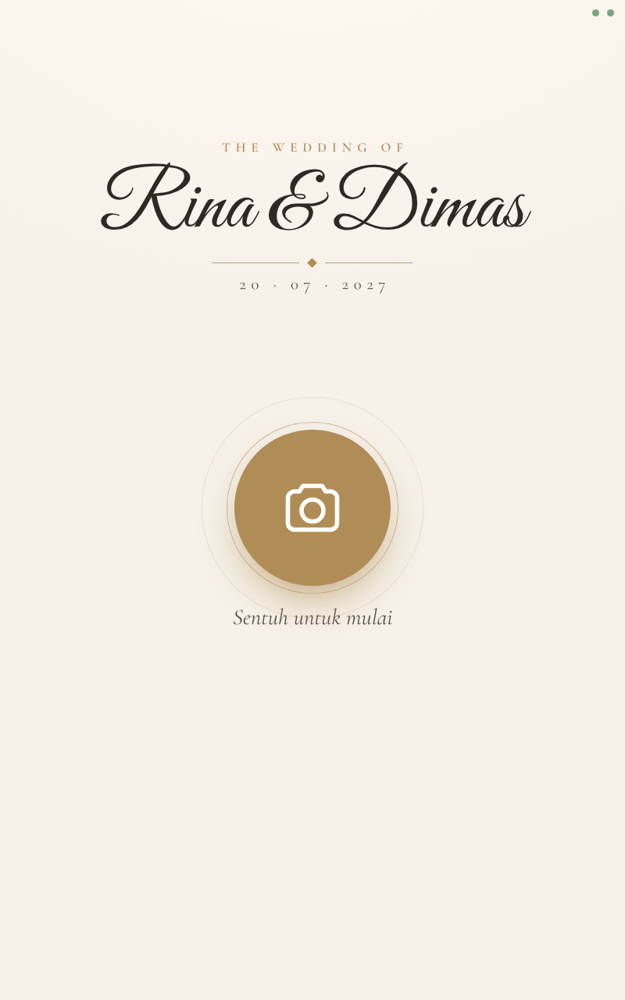
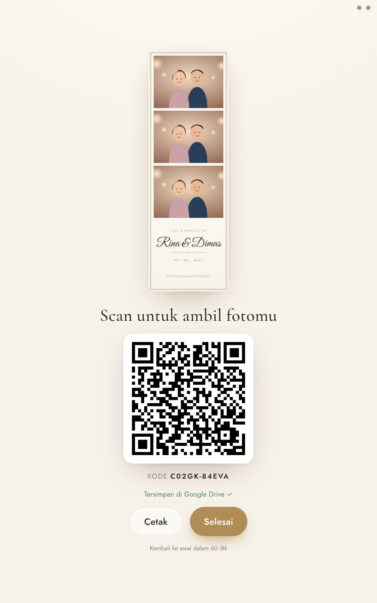
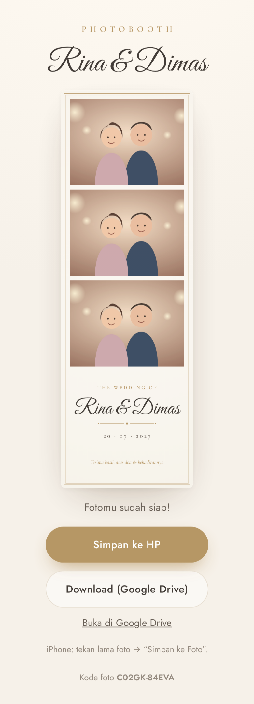
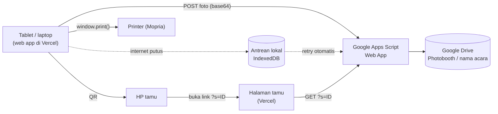

# 📸 Photobooth Mandiri — Wedding & Event

Photobooth swalayan berbasis web: tamu pilih bingkai → foto otomatis → hasil PNG → **QR** untuk diambil di HP → tersimpan di **Google Drive** → bisa **dicetak**. Tanpa payment gateway (dibayar di muka).

**Biaya software: Rp 0** — hosting statis di Vercel + backend Google Apps Script + Google Drive.

| Layar awal | Hasil + QR | Halaman tamu (HP) |
|---|---|---|
|  |  |  |

> 📱 **Setting perangkat (tablet, Pocket 3, printer, lampu, box): lihat [DEVICE-SETUP.md](DEVICE-SETUP.md).**

---

## Fitur
- **Kiosk tamu:** sentuh → pilih bingkai → hitung mundur → jepret otomatis (1–8 foto sesuai bingkai) → review / ulang → simpan → QR.
- **3 bingkai bawaan** (Klasik 4R, Photo Strip 2×6, Kolase 4 foto) — teks nama, tanggal, warna aksen diatur dari admin.
- **Bingkai sendiri:** desain di Canva gratis dengan kotak hijau `#00FF00` sebagai area foto, atau PNG transparan. Kotak terdeteksi otomatis.
- **Google Drive:** 1 folder per acara, file di-share "siapa saja yang punya link".
- **Tahan internet putus:** foto disimpan di tablet (IndexedDB) → antrean upload dengan retry otomatis. **QR tetap berlaku.**
- **Halaman tamu:** pratinjau, *Simpan ke HP* (share sheet), download, buka di Drive.
- **Cetak:** Android via Mopria (mis. Canon SELPHY CP1500), strip dicetak 2× per lembar 4R.
- **Panel admin ber-PIN:** acara, kamera, sesi, bingkai, Drive & QR, cetak, galeri lokal, sistem + log error.
- **PWA offline:** sekali dibuka, aplikasi tetap bisa jalan walau internet venue mati.

## Arsitektur

Vercel hanya menyajikan file statis; bagian "dinamis" (simpan ke Drive) dikerjakan Apps Script — jadi tidak kena batas ukuran body fungsi serverless.

## Struktur repo
```
index.html            UI (kiosk, admin, halaman tamu) + CSS
app.js                Logika aplikasi (tanpa build step)
sw.js                 Service worker (cache offline)
manifest.webmanifest  PWA (install ke home screen, layar penuh)
icons/ fonts/ vendor/ Aset (font OFL, qrcode-generator MIT)
apps-script/Code.gs   Backend Google Drive — DITEMPEL di script.google.com, bukan di-deploy ke Vercel
tests/                Tes lokal (mock Apps Script + Chrome headless)
docs/img/             Gambar README
DEVICE-SETUP.md       Panduan setting perangkat & checklist hari H
```

---

## 1. Deploy ke Vercel (dari GitHub)
1. Vercel → **Add New → Project** → import repo ini.
2. **Framework Preset: Other**. Build Command & Output Directory: **kosongkan** (situs statis dari root).
3. Deploy → dapat URL produksi, mis. `https://photobooth-xxxx.vercel.app`.
4. Setiap `git push` ke `main` → deploy otomatis.

> ⚠️ Buka tablet di **URL produksi** (bukan URL preview per-commit). URL preview bisa diproteksi login Vercel → link QR tamu tidak bisa dibuka. Kalau perlu, isi Admin › Drive & QR › *URL halaman tamu* dengan URL produksi.
>
> ℹ️ Paket **Hobby** Vercel hanya untuk pemakaian pribadi/non-komersial. Kalau photobooth disewakan, gunakan paket berbayar atau host statis lain.

`.vercelignore` mengecualikan `apps-script/`, `tests/`, `docs/`, dan file `.md` dari deployment.

## 2. Backend Google Drive (Apps Script, ±5 menit)
1. Buka **script.google.com** → *New project* → hapus isi → tempel `apps-script/Code.gs`.
2. Ganti `TOKEN` dengan teks acak (bisa pakai tombol **Acak** di Admin › Drive & QR lalu salin). **Jangan commit token asli ke GitHub** — token cukup ada di editor Apps Script dan di tablet.
3. **Deploy → New deployment → ⚙ Web app** — *Execute as:* **Me** · *Who has access:* **Anyone**.
4. *Authorize access* → pilih akun → **Advanced → Go to … (unsafe) → Allow** (normal untuk script pribadi).
5. Salin **Web app URL** (`…/exec`) → tempel di tablet: Admin › Drive & QR → **Tes koneksi** harus ✓.

Foto tersimpan di `My Drive › Photobooth › <nama folder acara>`.
Ubah kode backend: *Deploy → Manage deployments → ✎ → Version: New version → Deploy* — URL tetap.

Opsi di `CONFIG` (Code.gs): `PUBLIC_EVENT_FOLDER: true` → folder acara bisa dibuka siapa saja yang punya link (QR galeri di layar awal) · `ROOT_FOLDER_ID` → simpan ke folder tertentu.

## 3. Pakai di tablet
Ringkas (detail di [DEVICE-SETUP.md](DEVICE-SETUP.md)):
1. Buka URL produksi di **Chrome** → izinkan **Kamera**.
2. **Admin:** ketuk **pojok kiri atas 5×** → PIN `1234` (laptop: `Ctrl+Shift+A`). Ganti PIN di *Sistem*.
3. Isi *Drive & QR*, *Acara*, pilih *Bingkai*.
4. Chrome ⋮ → **Install app / Add to Home screen** → buka dari ikon.

## 4. Rilis versi baru
1. Ubah kode → naikkan `VERSION` di `app.js` **dan** `CACHE` di `sw.js`.
2. `git push` → Vercel deploy otomatis.
3. Di tablet: Admin › Sistem › **Paksa update** (atau tutup-buka aplikasi 2×).

## 5. Tes lokal
```bash
node tests/gas-test.js                      # logika Code.gs, tanpa dependensi (17 cek)
cd tests && npm install && npx playwright install chromium
npm run test:e2e                            # alur lengkap di Chrome headless + kamera palsu (25 cek)
```
Opsional: `FAKE_VIDEO=/path/video.y4m` untuk gambar kamera yang lebih realistis; `CHROME_PATH=...` untuk Chrome sistem. Mock backend saja: `node tests/mock-api.js` (token `TEST-TOKEN`).

## Troubleshooting
| Gejala | Penyebab / solusi |
|---|---|
| Layar hanya ikon kamera, tanpa teks | `index.html` dibuka tanpa `app.js` (mis. langsung dari dalam ZIP). Versi ini menampilkan panel "Aplikasi belum termuat". Buka lewat URL Vercel. |
| "Respon bukan JSON" | Deployment Apps Script harus *Who has access: Anyone*; setelah ubah Code.gs buat *New version*. |
| "Token salah" | Samakan `TOKEN` di Code.gs dengan token di Admin. |
| Kamera tidak tampil | Chrome › ikon gembok › Izin situs › Kamera: Izinkan · harus HTTPS. |
| Tamu buka link: foto belum ada | Masih antre upload — halaman tamu memuat otomatis. Cek titik status & Admin › Drive & QR. |
| Link tamu minta login Vercel | Kiosk dibuka di URL preview — pakai URL produksi. |
| Perlu diagnosa di tablet | Admin › Sistem › **Log error**. |

## Batasan
- Apps Script akun Gmail: maks 6 menit per eksekusi, 30 eksekusi bersamaan per user — cukup untuk 1 booth.
- Google Drive gratis 15 GB (dibagi dengan Gmail/Photos). JPG 92% jauh lebih kecil dari PNG (Admin › Sesi › Format).
- Kirim otomatis ke WhatsApp belum ada (butuh WhatsApp Business API, berbayar setelah kuota gratis). Tamu mengambil foto lewat QR.

## Lisensi pihak ketiga
qrcode-generator © Kazuhiko Arase (MIT) · Font Great Vibes, Cormorant Garamond, Jost (SIL Open Font License — `fonts/LICENSE-*`).
